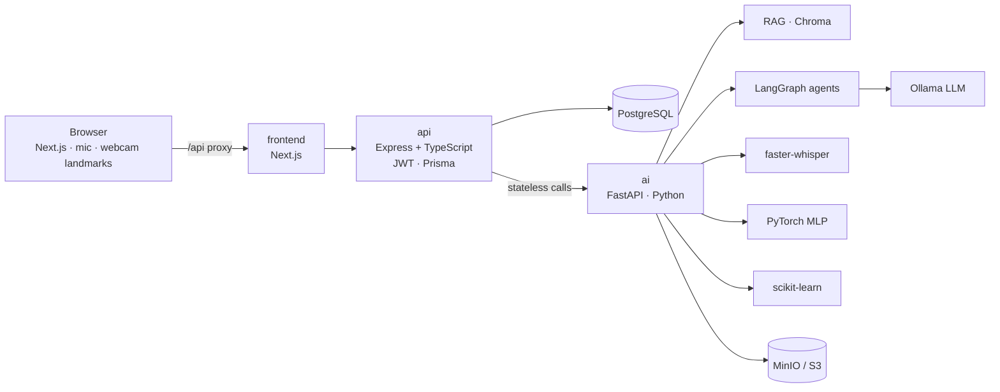

# mockai — AI Mock Interview Coach

**Practise the interview before the interview.** Upload your resume and a job description, then answer
questions out loud. mockai asks questions about *your* experience for *that* job, listens to your spoken
answers, watches eye contact through the webcam, scores every answer, and writes a coaching report. A
dashboard tracks your progress over time.

Everything runs **locally and for free** on a 16 GB laptop with no GPU. No paid APIs.

> 📽️ **Demo:** _GIF placeholder — `docs/media/demo.gif` (record: upload → spoken answer → report → dashboard)_

---

## The problem
Candidates rehearse alone, with generic question lists and no feedback on *how* they sound. Human mock
interviews are expensive and hard to schedule. mockai gives instant, specific, private feedback on
content (relevance, depth, structure) **and** delivery (pace, filler words, eye contact).

## What it does
| Step | What happens | Tech |
|---|---|---|
| 1. Upload | Resume PDF + job description are chunked, embedded and indexed | LangChain, sentence-transformers, ChromaDB |
| 2. Questions | Questions are written from the JD requirements matched to your resume, with citations ("why this question?") | RAG + local LLM (Ollama, Qwen2.5-7B) |
| 3. Answer out loud | Questions are read aloud; your answer is recorded and transcribed with word timestamps | MediaRecorder, faster-whisper |
| 4. Delivery analysis | Filler words, words per minute, long pauses, JD keyword coverage | NLTK |
| 5. Eye contact | The browser extracts 45 face-landmark numbers every 500 ms (never video); a small neural net classifies attentive vs looking away | MediaPipe, PyTorch |
| 6. Scoring & follow-ups | An Evaluator agent scores relevance / depth / clarity / STAR as validated JSON; an Interviewer agent asks follow-ups when an answer is vague | LangGraph, Pydantic |
| 7. Report | A Coach agent writes strengths, priorities and a practice plan | LangGraph |
| 8. Progress | Trends across interviews, weakest topics, your personal filler words | Pandas, Recharts |

## Architecture

Monorepo: `frontend/` · `api/` · `ai/` · `ml/` · `infra/` · `docs/`. Details: [docs/ARCHITECTURE.md](docs/ARCHITECTURE.md).

## Results
Answer-quality models compared on the **same held-out test set** (165 answers, scores 1–5):

| Model | Accuracy | Macro-F1 | MAE ↓ | QWK |
|---|---|---|---|---|
| Majority class (no skill) | 0.218 | 0.072 | 1.842 | 0.000 |
| Length only | 0.309 | 0.287 | 1.030 | 0.531 |
| TF-IDF + Logistic Regression | 0.394 | 0.402 | 0.770 | 0.698 |
| Keras embedding + MLP | 0.503 | 0.504 | 0.636 | 0.749 |
| Qwen2.5-0.5B zero-shot / + LoRA | _run the Colab notebook → [ml/results/RESULTS.md](ml/results/RESULTS.md)_ | | | |

Honest note: this test set comes from a template-generated, rubric-labelled seed dataset, so the numbers
are optimistic; scripts for LLM-generated, human-labelled data are included
([docs/MANUAL_STEPS.md](docs/MANUAL_STEPS.md)). Other measured numbers: Whisper `small` int8 transcribes
9 s of speech in ~3 s on a laptop CPU, with filler words preserved.

## Screenshots
_Placeholders — add images to `docs/media/` after running the app:_
| Interview room | Feedback report | Progress dashboard |
|---|---|---|
| `docs/media/interview.png` | `docs/media/report.png` | `docs/media/dashboard.png` |

## Engineering highlights
- **Strict LLM output**: JSON mode + Pydantic schemas + self-correcting retries + labelled fallbacks — the
  interview never dead-ends if the LLM is slow or wrong.
- **Privacy by design**: face tracking runs in the browser; only 45 numbers per frame reach the server.
- **Train/serve skew guards**: shared feature, prompt and input-format code between training and serving,
  enforced by tests (e.g. a test diffs the TypeScript and Python landmark lists).
- **Testable AI**: every model sits behind an override hook; 60+ pytest and 25+ vitest tests run offline in seconds.
- **DevOps**: one-command docker-compose; Kubernetes manifests (StatefulSet, Jobs, probes, limits) validated
  in CI with kubeconform and a kind server-side dry run; CI lints, tests and builds all three images.
- **Fine-tuning on a free GPU**: LoRA on Qwen2.5-0.5B in Colab (T4, ~20 min), exported to GGUF for Ollama.

## Run it
```bash
cp infra/.env.example infra/.env      # set JWT_SECRET + INTERNAL_API_KEY
docker compose -f infra/docker-compose.yml up -d --build
docker compose -f infra/docker-compose.yml exec ollama ollama pull qwen2.5:7b-instruct
# open http://localhost:3000
```
Dev mode, tests and troubleshooting: [docs/SETUP.md](docs/SETUP.md) · Kubernetes: [infra/k8s/README.md](infra/k8s/README.md) ·
Free deployment options: [docs/DEPLOYMENT.md](docs/DEPLOYMENT.md).

## What I learned
- **RAG is mostly retrieval design**: matching each JD requirement to resume chunks beat one big query, and
  citations make the output explainable.
- **Agents are control flow**: small single-purpose prompts plus explicit Python routing were far more reliable
  on a 7B model than one long prompt.
- **Use LLMs for judgement and code for counting**: filler words, pace, averages and attention are deterministic;
  the LLM only writes and judges.
- **Baselines keep you honest**: a length-only model already reached QWK 0.53 — any "smart" model must beat that.
- **Data beats architecture**: model behaviour exposed template artefacts in the synthetic dataset; real labelled
  data is the bottleneck.
- **ML engineering is mostly glue and guards**: version pins (PyAV, scikit-learn), skew tests, fallbacks and
  smoke tests caught more real bugs than model tuning did.

## Study notes
Every phase has notes with concepts, key files, interview questions and exercises: [docs/learn/](docs/learn/).
Decisions and their reasons: [docs/DECISIONS.md](docs/DECISIONS.md).
