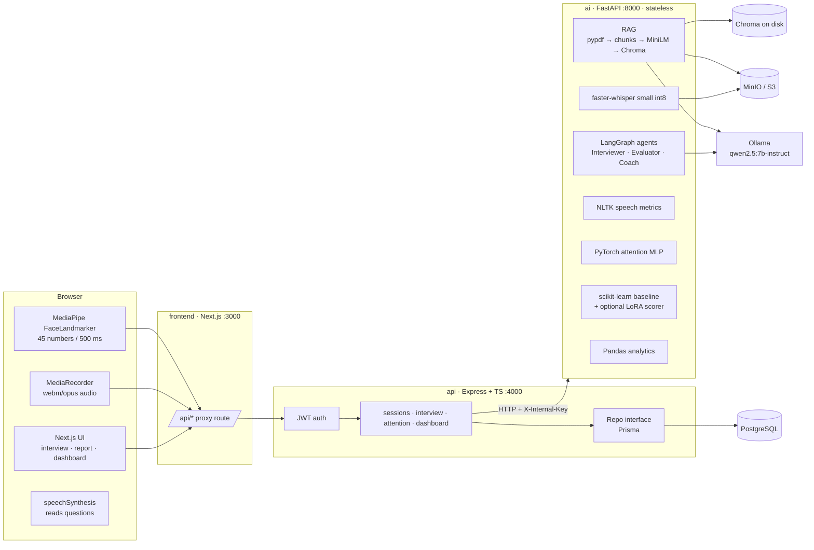
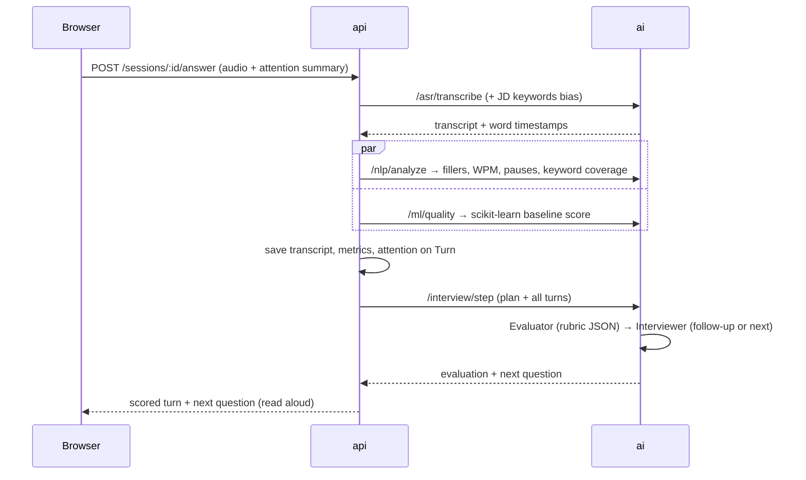

# Architecture

## System

## One answer, end to end

## Design principles
- **Free and local first**: every model runs on a 16 GB CPU laptop; hosted services are optional swaps
  (OpenAI-compatible LLM URL, S3 endpoint).
- **Stateless AI service**: the API owns all state in Postgres and sends what each call needs → AI pods
  scale horizontally (except the Chroma disk — see `infra/k8s/apps.yaml`).
- **Privacy**: no video leaves the browser (landmarks only); audio and resumes stay in your own MinIO.
- **Deterministic where possible, LLM where judgement is needed**: NLP metrics, attention, aggregates and
  baselines are code; question writing, scoring prose and coaching are LLM.
- **Graceful degradation**: every LLM step has a validated fallback; optional models (attention MLP, LoRA
  scorer, baseline) are skipped cleanly when absent.
- **Skew guards**: shared feature/prompt/input-format code between training and serving, enforced by tests.

## Data model (Prisma)
`User 1─* InterviewSession 1─* Turn`. A Turn holds the question (+ RAG sources), audio key, transcript,
word timestamps, NLP metrics, attention summary, Evaluator JSON, LLM score and baseline score — all JSON
columns, so new metrics don't need migrations. The session holds the RAG question plan and the Coach report.

## Repository map
| Path | What |
|---|---|
| `frontend/src/app/interviews/[id]/InterviewRoom.tsx` | interview state machine |
| `frontend/src/hooks/` | recorder, TTS, face landmarks, attention batching |
| `api/src/routes/` | auth, sessions, interview loop, dashboard |
| `ai/app/rag/`, `ai/app/agents/` | RAG + LangGraph |
| `ai/app/asr.py`, `nlp.py`, `vision/`, `quality.py`, `analytics.py` | speech, NLP, vision, ML, analytics |
| `ml/` | dataset, baselines, vision training, LoRA notebook, results |
| `infra/` | docker-compose, Kubernetes; CI in `.github/workflows/ci.yml` |
