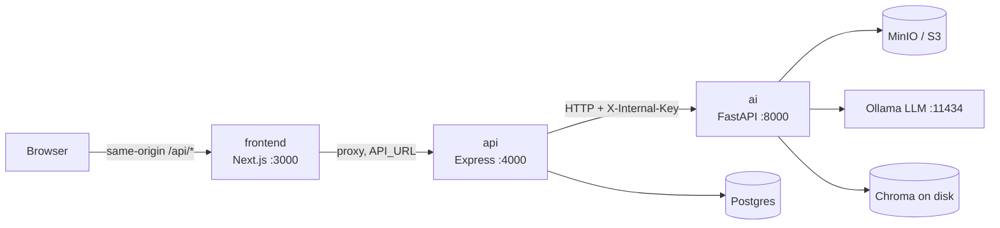

# Phase 0 — Monorepo, services, Docker, CI

## What was built
Three services that each say "hello", wired together, plus the infrastructure to run and test them.

- **frontend** — Next.js App Router. The browser never talks to Express directly: `src/app/api/[...path]/route.ts` forwards every `/api/*` call. That gives us one origin (no CORS) and lets the API address be a runtime env var (`API_URL`).
- **api** — Express + TypeScript. The "gateway": auth, users, sessions, DB. `createApp()` builds the app without starting a server so tests can call it in-memory with supertest.
- **ai** — FastAPI (Python) because the AI ecosystem (LangChain, PyTorch, Whisper) is Python-first. Stateless: everything it needs comes in the request; storage is Chroma + MinIO.
- **infra/docker-compose.yml** — Postgres, MinIO (+ a one-shot container that creates the bucket), Ollama, and the three services. One command starts all.
- **.github/workflows/ci.yml** — on every push: lint + tests per service, then build each Docker image.

## Concepts from zero
- **Monorepo**: several apps in one git repo. Pro: one PR can change API + frontend together; one CI. Con: CI must build each part separately (we use a job per service).
- **Microservice split by language**: Node is great for I/O + web; Python owns ML. They talk over HTTP/JSON — the simplest contract to debug (`curl` it).
- **Docker image vs container**: image = frozen filesystem + start command (built from a `Dockerfile`); container = a running instance. **Multi-stage builds** (`FROM ... AS build` then a second `FROM`) keep compilers and dev deps out of the final image.
- **docker-compose**: declares many containers, their env vars, ports, volumes (persistent disks) and start order (`depends_on` + `healthcheck`). Containers reach each other by service name (`http://ai:8000`).
- **Environment-based config (12-factor)**: code reads `process.env` / `pydantic-settings`; the same image runs everywhere with different env vars. Secrets are never in git, only `.env.example`.
- **S3 API**: MinIO speaks the same HTTP API as AWS S3, so boto3 code moves to AWS by changing the endpoint URL and keys.
- **Ollama**: runs open-weight LLMs locally and exposes an **OpenAI-compatible** API at `/v1`, so any OpenAI client library works against it.
- **CI (Continuous Integration)**: a robot runs lint/tests/build on every push so broken code is caught before merging.

## Files to read
1. `infra/docker-compose.yml` — the whole system on one page.
2. `frontend/src/app/api/[...path]/route.ts` — the backend-for-frontend proxy.
3. `api/src/app.ts` — Express app factory + central error handler.
4. `ai/app/config.py` — every knob of the AI service, read from env vars.
5. `.github/workflows/ci.yml` — what is checked on every push.

## Interview questions
1. **Why split Node and Python services instead of one backend?**
   The web/auth/CRUD side fits Node + TypeScript (same language as the frontend, Prisma, great I/O). ML libraries are Python-native. Splitting lets each use its best ecosystem and scale independently — AI inference is CPU-heavy, the API is light — at the cost of a network hop and two deployables.
2. **Why proxy API calls through Next.js instead of calling Express from the browser?**
   Same-origin means no CORS config, cookies/headers stay simple, and the backend address is a server-side runtime variable, so one Docker image works in compose and Kubernetes. It also hides internal service URLs from the client.
3. **What does a multi-stage Docker build give you?**
   The first stage has the toolchain (TypeScript, dev deps) and produces build output; the final stage copies only the output and production deps. Images are smaller, faster to pull, and have less attack surface.
4. **How do services find each other in docker-compose?**
   Compose creates a private network with DNS: each service name resolves to its container. `AI_SERVICE_URL=http://ai:8000`. `depends_on` with `condition: service_healthy` waits for healthchecks (e.g. `pg_isready`).
5. **How do you keep secrets out of the repo?**
   `.gitignore` excludes `.env*` except `.env.example`; code reads secrets from env vars; compose uses `${JWT_SECRET:?...}` so it refuses to start without one; Kubernetes uses a Secret (template only in git).

## Exercises
1. Change `/health` in `ai/app/main.py` to also return `"version": "0.1.0"`. Run `pytest -q` — the test still passes. Now add an assertion for the version in `tests/test_health.py`, break the value on purpose, and watch it fail.
2. In `infra/docker-compose.yml`, change the frontend port mapping to `"3001:3000"`. Run compose and open http://localhost:3001. Explain why the *container* port didn't change and why the frontend could still reach the API (hint: it uses `http://api:4000`, not localhost).
