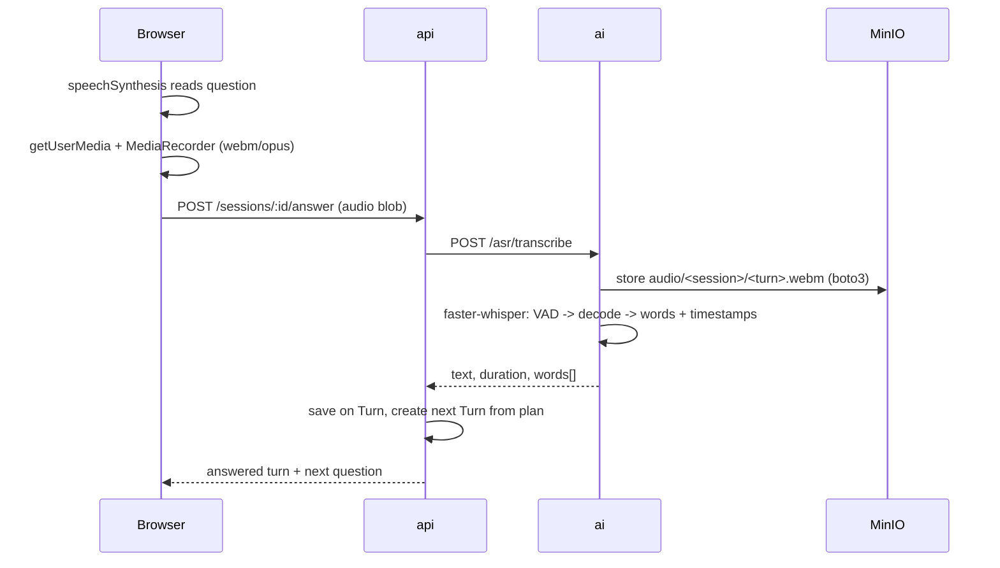

# Phase 2 — Interview UI, audio recording, speech-to-text

## What was built
The interview page reads each question aloud, records your spoken answer in the browser,
uploads it, and shows the transcript. The AI service turns audio into text with word timings.

## Concepts from zero
- **MediaRecorder**: browser API that encodes a live `MediaStream` (from `getUserMedia`) into a
  compressed file. We use Opus in a WebM container — speech-optimised, ~16 KB/s.
- **Sound as data**: audio = air pressure sampled 16,000×/s. Whisper converts it into a
  **log-Mel spectrogram**: for each 10 ms frame, how much energy is in each of 80 frequency bands
  (spaced like human hearing). It's an image of sound; the encoder "looks" at it.
- **Whisper (encoder–decoder transformer)**: the encoder reads the spectrogram, the decoder writes
  text tokens one at a time, attending to the audio — like a language model whose prompt is audio.
- **Quantization (int8)**: store each weight as an 8-bit integer + a scale factor instead of a
  32-bit float. 4× smaller, faster matrix maths on CPU, ~1% accuracy loss.
- **Greedy vs beam search**: greedy takes the most likely next token; beam search keeps the top-k
  partial transcripts. Beam is slightly more accurate, k× slower.
- **VAD (voice activity detection)**: a tiny model (Silero) that marks speech vs silence; we only
  transcribe speech, which also prevents Whisper "hallucinating" text in long pauses.
- **Word timestamps**: start/end time of every word — needed for words-per-minute and pauses.
- **Prompting an ASR model**: `initial_prompt` is fed as earlier context. Whisper copies the style
  of the prompt, so a disfluent prompt ("Umm, let me think like, hmm…") keeps fillers it would
  otherwise clean up, and JD terms ("Kubernetes") improve spelling of jargon.
- **Dependency pinning**: we hit a real bug — newer PyAV removed an argument faster-whisper still
  passes. Root cause found in the traceback; fix = pin `av>=16,<17`, not patch library code.

## Files to read
1. `ai/app/asr.py` — model loading (lazy, thread-safe), transcribe options, prompt trick.
2. `frontend/src/hooks/useRecorder.ts` — mic permission, MediaRecorder, cleanup.
3. `frontend/src/app/interviews/[id]/InterviewRoom.tsx` — the interview state machine.
4. `api/src/routes/interview.ts` — answer → transcribe → next question; finish.
5. `ai/tests/test_asr.py` — how to test ML code with a fake model.

## Interview questions
1. **Why transcribe on the server instead of the browser's Web Speech API?**
   Web Speech recognition isn't available in all browsers, sends audio to the vendor's cloud, and
   gives no word timestamps or confidence. faster-whisper is local, private, consistent, and gives
   word timings for speech analytics.
2. **How did you make Whisper fast enough on a CPU?**
   `small` model, CTranslate2 backend with int8 quantization, greedy decoding, VAD to skip silence,
   and loading the model once per process. Measured: 9 s of speech in ~3 s on a laptop.
3. **Whisper removes "um" and "uh" — how do you count filler words?**
   Prompt engineering for ASR: an `initial_prompt` written with fillers makes the decoder imitate
   that style, so fillers stay in the transcript. Verified with a synthesized test clip.
4. **How do you test code that depends on a 500 MB model?**
   The model sits behind `get_model()` with an override hook; tests inject a fake that returns the
   same shapes (segments generator + info). We test our logic (mapping, options, endpoint
   validation), not Whisper itself — that gets a separate manual smoke test.
5. **What happens if the user's mic is blocked or the recording is too short?**
   `getUserMedia` throws `NotAllowedError` → friendly message. Answers < 2 s are rejected in the UI;
   the API validates mime type and size (multer), and the AI returns 400 for undecodable audio.

## Exercises
1. In `asr.py`, set `initial_prompt=None`, record an answer with lots of "um"s, and compare the
   transcript. Then restore it. (Phase 4's filler count depends on this.)
2. Change `WHISPER_MODEL=base` in `ai/.env`, restart, and time a 30 s answer vs `small`. Note the
   speed/accuracy trade-off on technical words like "PostgreSQL".
