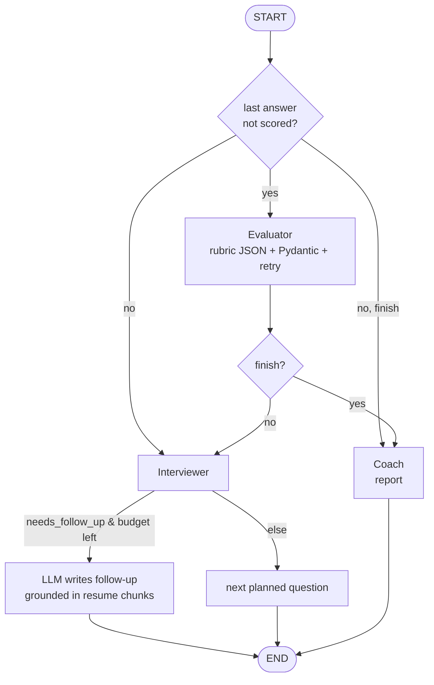

# Phase 3 — LangGraph agents (Interviewer, Evaluator, Coach) + report

## What was built
After each answer, an **Evaluator** agent scores it and an **Interviewer** agent decides whether
to probe with a follow-up or move to the next planned question. When the user finishes, a
**Coach** agent writes the report. All three run inside one LangGraph graph.

Per answer the API calls `/interview/step` once: Evaluator → Interviewer. On finish: Coach.
The AI service is **stateless**: the API sends the plan + all turns each time, so any AI pod can
serve any request.

## Concepts from zero
- **Agent**: an LLM given a role, instructions and (sometimes) tools, whose output drives what
  happens next. Here each agent has one narrow job and its own prompt.
- **Why multiple agents instead of one prompt?** Smaller prompts are more reliable on a 7B model,
  each output can be validated separately, and the *control flow* (follow up or not? report now?)
  lives in readable Python instead of hoping the model follows a long instruction list.
- **LangGraph**: define a `StateGraph` over a typed state. Nodes return partial updates; LangGraph
  merges them. **Conditional edges** call a router function on the state to pick the next node.
  `compile()` produces a runnable; `invoke(state)` runs until `END`.
- **Structured output**: the Evaluator must return integers 1–5, booleans and short lists. Pydantic
  enforces it (`Field(ge=1, le=5)`); invalid → we re-prompt with the error (self-correction);
  still invalid → heuristic fallback marked `fallback: true` so the UI can label it.
- **LLM-as-a-judge**: using an LLM to grade text against a rubric. Known weaknesses: leniency,
  position/verbosity bias, inconsistency. Mitigations used: explicit rubric per score, low
  temperature, computing the overall score in code (weighted mean), and in phase 6–7 comparing with
  trained models.
- **STAR**: Situation, Task, Action, Result — the standard structure for behavioural answers. The
  Evaluator reports which parts are present.
- **Human-readable numbers come from code, words from the LLM**: the Coach receives exact averages
  computed in Python and only writes prose — no arithmetic hallucinations.

## Files to read
1. `ai/app/agents/graph.py` — the graph wiring and routers (short!).
2. `ai/app/agents/evaluator.py` — rubric prompt, schema, weighted overall, fallback.
3. `ai/app/agents/interviewer.py` — the follow-up decision policy.
4. `ai/app/agents/coach.py` — deterministic aggregates + LLM narrative.
5. `api/src/routes/interview.ts` — how the API drives the graph and rolls back on failure.

## Interview questions
1. **Walk me through your agent architecture.**
   Three nodes in a LangGraph state graph. Evaluator scores the latest answer as validated JSON.
   A router sends the flow to the Interviewer (follow-up or next question) or to the Coach when the
   user finishes. The API persists everything in Postgres and sends the state each call, so the AI
   service is stateless and horizontally scalable.
2. **How do you guarantee the evaluator's output is usable?**
   JSON mode, Pydantic schema with ranges, retry with the validation error shown to the model, and a
   labelled heuristic fallback. The overall score is computed in code, not by the model.
3. **How does the interviewer decide to ask a follow-up?**
   The Evaluator sets `needs_follow_up` + a reason. The Interviewer follows up only if the last turn
   was a main question, the score wasn't a fallback, and the follow-up budget (2) isn't used. The
   follow-up itself is generated with the answer + the most relevant resume chunks (RAG).
4. **What are the risks of LLM-as-a-judge and how would you evaluate the evaluator?**
   Bias toward long answers, inconsistency between runs, leniency. I'd build a labelled set of
   answers (phase 6 dataset), measure agreement (MAE, Cohen's quadratic kappa) between LLM scores and
   human labels, and compare with cheaper trained models (TF-IDF baseline, LoRA fine-tune).
5. **Why not let the LLM keep conversation memory itself?**
   Explicit state in the DB is auditable, survives restarts, and works across replicas. Long chat
   histories also slow down CPU inference and drift; we send only what each agent needs.

## Exercises
1. In `interviewer.py` set `DEFAULT_MAX_FOLLOWUPS = 0`. Run `pytest tests/test_agents.py -q` — which
   test fails and why? Restore it.
2. Change `WEIGHTS` in `evaluator.py` to make `depth` 0.5 and `clarity` 0.0. Predict how
   `test_overall_is_weighted_mean` behaves, then run it. What does weighting say about what *you*
   think matters in an interview?
