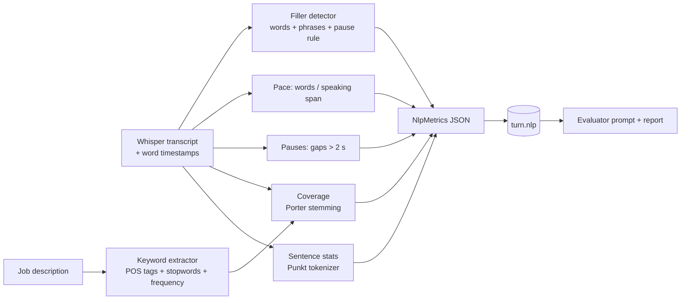

# Phase 4 — NLP speech analysis (NLTK)

## What was built
Every transcribed answer gets deterministic speech metrics — no LLM involved:
filler words, words per minute, long pauses, job-description keyword coverage, sentence length
and vocabulary richness. The Evaluator agent sees these numbers; the report shows them.

## Concepts from zero
- **Tokenization**: splitting text into units. Words: we use a regex that keeps tech tokens
  (`node.js`, `c++`, `c#`). Sentences: NLTK **Punkt**, an unsupervised model that learned which
  periods end sentences (it won't split "e.g. Docker").
- **Stopwords**: frequent function words ("the", "is", "and"). Removing them leaves content words.
  We add job-ad noise ("experience", "team", "strong") as domain stopwords.
- **POS tagging**: labelling words as noun/verb/adjective… (Penn tags like `NN`, `NNP`, `VB`). The
  averaged-perceptron tagger is a small linear classifier using features like suffixes and
  neighbouring words. Skills are mostly nouns, so we keep `NN*` + tokens that look technical.
- **Stemming**: rule-based suffix stripping (Porter): `deployed → deploy`, `APIs → api`. Cheaper
  and cruder than lemmatization (dictionary-based: `better → good`), good enough for matching.
- **Rule-based vs ML**: fillers like "um" are unambiguous; "like" isn't ("I like Python" vs "it
  was, like, slow"). Rule: count ambiguous words only next to a comma, because Whisper writes
  short pauses as commas. Transparent, testable, and explainable — a good first baseline.
- **Pace from timestamps**: WPM = words ÷ (last word end − first word start). Using the recording
  length would penalise people who pause before starting.
- **Lexical diversity (type–token ratio)**: unique words ÷ total words. Low = repetitive.

## Files to read
1. `ai/app/nlp.py` — every metric, ~200 lines, heavily commented.
2. `ai/tests/test_nlp.py` — the edge cases (the "like" rule, stemming, empty answers).
3. `api/src/routes/interview.ts` — order: ASR → NLP → agents.
4. `ai/app/agents/evaluator.py` (`_speech_notes`) — how metrics enter the LLM prompt.
5. `frontend/src/components/Feedback.tsx` — how metrics are shown with thresholds.

## Interview questions
1. **Why compute speech metrics with classic NLP instead of asking the LLM?**
   They're exact, instant, free, reproducible and testable. An LLM counting "um"s is slow and
   unreliable. Use the LLM where judgement is needed (content quality), rules where counting is.
2. **How do you avoid counting "like" in "I like Python" as a filler?**
   Context rule: ambiguous words count only in pause position (adjacent to a comma). Whisper inserts
   commas at short pauses. It's a heuristic; I'd validate it on labelled transcripts and could
   replace it with a small classifier on context-window features.
3. **How are JD keywords extracted?**
   Tokenize, POS-tag, keep nouns and tech-looking tokens, drop English + job-ad stopwords, rank by
   frequency then first position, keep the top 15. Coverage compares Porter stems so "deployed"
   matches "deploy". Alternatives: TF-IDF across many JDs, KeyBERT (embeddings), or the LLM.
4. **Why words-per-minute from word timestamps?**
   It measures the speaking span, excluding the silence before the first and after the last word,
   so a user who thinks for 5 s before answering isn't marked slow.
5. **How did NLP output also improve the ASR?**
   The same keyword extractor feeds Whisper's `initial_prompt`, biasing decoding toward the job's
   vocabulary ("Kubernetes", "PostgreSQL") — less misspelled jargon.

## Exercises
1. Add "honestly" to `FILLERS` in `nlp.py`, write a test in `test_nlp.py` that expects it to be
   counted, and run `pytest tests/test_nlp.py -q`.
2. Change `LONG_PAUSE_SEC` to `1.0`. Which test changes? Record yourself answering with deliberate
   pauses and compare the `long_pauses` count in the report for 1.0 vs 2.0.
