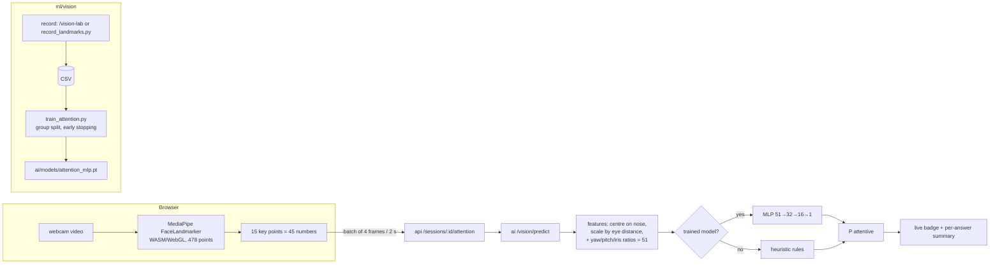

# Phase 5 — Vision: landmarks → PyTorch attention classifier

## What was built
While you answer, the webcam estimates whether you're looking at the screen. The browser runs
Google's MediaPipe face model locally, keeps 15 key points (45 numbers) every 500 ms, and sends
only those numbers. A tiny PyTorch MLP in the AI service returns P(attentive). Each answer gets
an attention summary (eye-contact %, glances away) shown in the report.

## Concepts from zero
- **Face landmarks**: a model outputs (x, y, z) coordinates of fixed facial points (eye corners,
  nose tip, irises…). x/y are normalised to image size; z is relative depth.
- **Edge inference / privacy by design**: running the heavy vision model in the browser means no
  video upload (privacy, bandwidth, server cost). The server sees 45 floats.
- **Feature engineering**: raw coordinates depend on where you sit. We subtract the nose position
  (translation invariance) and divide by the eye-corner distance (scale invariance), then add
  hand-made features — head yaw/pitch proxies and iris position inside each eye.
- **MLP**: stacked linear layers with ReLU between them; outputs one logit; sigmoid → probability.
  Trained with **binary cross-entropy**, the **Adam** optimiser, mini-batches, **dropout** and weight
  decay against overfitting, and **early stopping** on validation loss.
- **Standardisation**: scale each feature to mean 0 / std 1 using *training* statistics; save them
  with the weights and reuse at inference.
- **Data leakage & group split**: consecutive frames are near-duplicates. A random split puts
  twins in train and test → inflated accuracy. We split by **recording**.
- **Class imbalance**: `pos_weight` in the loss up-weights the rarer class.
- **Train/serve skew**: if training and production compute inputs differently, the model silently
  degrades. Guards: one shared feature function, a test that checks the browser's landmark list
  equals the Python list, and a browser recorder that uses the production extractor.
- **Heuristic fallback / cold start**: rules work before any data exists; the model replaces them.

## Files to read
1. `ai/app/vision/features.py` — landmark contract + normalisation + engineered features.
2. `ai/app/vision/training.py` — training loop, group split, early stopping, metrics.
3. `ai/app/vision/model.py` — MLP definition, checkpoint loading, heuristic fallback.
4. `frontend/src/hooks/useFaceLandmarks.ts` + `useAttention.ts` — browser side.
5. `ml/vision/README.md` — how much data to record and why.

## Interview questions
1. **Why send landmarks instead of video frames?**
   Privacy (no faces stored or transmitted), ~200 bytes vs ~50 KB per frame, and the server needs no
   GPU — MediaPipe runs on the user's device with WebGL/WASM. The server model is tiny and fast.
2. **How do you make the model robust to where the user sits?**
   Normalise: centre on the nose tip and divide by inter-ocular distance; add relative features
   (iris position within the eye, nose position between cheeks) that don't depend on absolute position.
3. **How much data do you need and how do you split it?**
   ~500–1,500 frames per class across ≥ 3 recordings with varied lighting/glasses/directions. The model
   has ~2.3k weights, so variety matters more than volume. Split by recording to avoid leakage.
4. **What is train/serve skew and how did you prevent it here?**
   Training inputs differing from production inputs. One shared `to_features`, a test that diffs the
   TS and Python landmark lists, and a browser-based recorder using the production extractor.
5. **Why an MLP and not a CNN?**
   The input is already a compact geometric description (51 numbers), not pixels. CNNs learn spatial
   filters from images; here the "vision" part is done by MediaPipe. An MLP is the right size — fast,
   small, easy to train on a few thousand samples.

## Exercises
1. Run `python ml/vision/train_attention.py --synthetic`, then shrink the network in `build_mlp`
   (e.g. `hidden=(4, 2)`) and compare accuracy. Where does it stop learning?
2. In `group_split`, replace the group logic with a random 80/20 split of *frames*. Train on your
   real recordings both ways and compare test accuracy — the difference is leakage.
