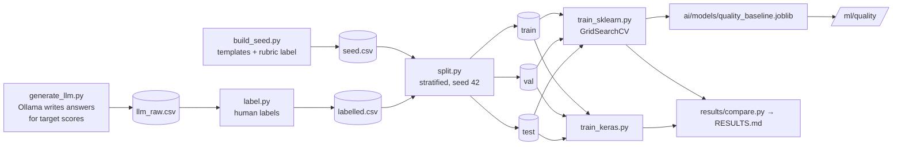

# Phase 6 — Classic ML baselines (scikit-learn + Keras) and the dataset builder

## What was built
A labelled dataset of interview answers (score 1–5), and three kinds of models trained to predict
the score: no-skill baselines, TF-IDF + logistic regression (scikit-learn) and a small Keras neural
network — all evaluated on the **same** held-out test set. The scikit-learn model is served by the AI
service as a second opinion next to the LLM evaluator, and as its fallback.

## Results (seed data — synthetic, so optimistic)
| Model | Accuracy | Macro-F1 | MAE ↓ | Within ±1 | QWK |
|---|---|---|---|---|---|
| Majority class | 0.218 | 0.072 | 1.842 | 0.436 | 0.000 |
| Length only | 0.309 | 0.287 | 1.030 | 0.752 | 0.531 |
| TF-IDF + LogReg | 0.394 | 0.402 | 0.770 | 0.867 | 0.698 |
| Keras embedding + MLP | 0.503 | 0.504 | 0.636 | 0.885 | 0.749 |

Reading it: length alone already gets QWK 0.53 — longer answers tend to score higher, a real bias to
watch for. TF-IDF adds content signal. The Keras model wins here, but its top features and the
TF-IDF "top words" (`as a result`, `our`, numbers) show both partly learned our **template phrasing**.
That's why the human-labelled LLM answers matter.

## Concepts from zero
- **Supervised learning**: learn a function from inputs (answer text) to labels (score) using examples.
- **Train / validation / test**: fit on train, tune on validation (or cross-validation), report once
  on test. Touching test while tuning = optimistic numbers.
- **Stratified split**: each split keeps the same label proportions.
- **Baselines**: majority class and length-only tell you how much your fancy model actually adds.
- **TF-IDF**: sparse vector per text; weight = how often a term appears in this answer × how rare it is
  across answers. N-grams (1–2) capture phrases like "as a result".
- **Logistic regression (multinomial)**: linear scores per class → softmax probabilities. Regularisation
  `C` trades fit vs simplicity; chosen by **GridSearchCV** (5-fold cross-validation).
- **Pipeline**: vectoriser + classifier saved as one object → same preprocessing at train and serve time.
- **Embeddings + average pooling (Keras)**: each word id → learned 64-d vector; averaging gives one vector
  per answer; dense layers classify. Learns similarity between words that TF-IDF treats as unrelated.
- **Ordinal metrics**: MAE and **QWK** (quadratic weighted kappa) punish "1 vs 5" more than "4 vs 5".
- **Expected score**: Σ P(class) × class turns probabilities into a smooth 1–5 number (e.g. 3.6).
- **Synthetic data & label noise**: templates let everything run offline, but models learn template
  artefacts. Real labels come from humans; re-labelling a sample measures your own consistency.
- **Model artefacts & versions**: a joblib pickle must be loaded with the same scikit-learn version → pinned.

## Files to read
1. `ml/dataset/build_seed.py` — how answers and labels are generated (and why that's biased).
2. `ml/classic/train_sklearn.py` — baselines, pipeline, grid search, explainability.
3. `ml/classic/metrics.py` — the shared metric definitions.
4. `ml/classic/train_keras.py` — the neural comparison.
5. `ai/app/quality.py` — serving: shared input format, expected score, graceful absence.

## Interview questions
1. **Why build baselines before the real model?**
   They define "no skill". Here a length-only model already reaches QWK 0.53, so a model at 0.55 would
   be nearly worthless. Baselines keep you honest and catch leakage (a baseline that's too good is a red flag).
2. **Why QWK and MAE instead of just accuracy?**
   Scores are ordinal. Predicting 4 for a 5 is nearly right; predicting 1 is badly wrong. Accuracy treats
   both as equally wrong. QWK is the standard for essay/answer scoring and corrects for chance agreement.
3. **TF-IDF + LogReg vs a neural net — when would you pick which?**
   TF-IDF+LR: tiny data, needs to be fast, explainable (inspect coefficients), trivial to serve. Neural
   (embeddings/transformers): more data, need semantics beyond exact words. Always compare on the same test set.
4. **What's wrong with your dataset and how would you fix it?**
   The seed set is template-generated, so models learn template phrasing and scores are optimistic. Fix:
   LLM-generated varied answers + human labels (scripts included), ideally two raters with agreement
   measured, and a test set made only of human-labelled real answers.
5. **How do you avoid train/serve skew for a text model?**
   Save vectoriser + model as one Pipeline, and build the input string with one function
   (`app.quality.model_input`) that the training script imports.

## Exercises
1. In `train_sklearn.py` remove the question from the input (`text_of` → only the answer). Re-run and
   compare QWK. Does knowing the question help on this data? Why might it matter more on real data?
2. Change `rubric_label` in `build_seed.py` so `vagueness` has weight 0, rebuild the seed set, re-split,
   retrain both models and run `compare.py`. Which model's metrics move most, and why?
