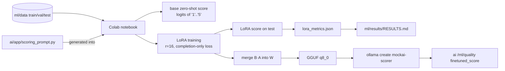

# Phase 7 — LoRA fine-tuning Qwen2.5-0.5B to score answers

## What was built
A Colab notebook that teaches a small open LLM (Qwen2.5-0.5B-Instruct, 494M params) to output an
interview score 1–5, using LoRA on the free T4 GPU, then compares it — on the **same test set** —
with the untouched base model and the classic baselines from phase 6. The result exports to GGUF so
Ollama can run it on a CPU laptop, and the AI service can use it as a third scorer (`SCORER_MODEL`).

## Concepts from zero
- **Fine-tuning**: continue training a pre-trained model on your task's examples so it adapts.
  Full fine-tuning updates every weight → needs memory for weights + gradients + optimizer state (~4×).
- **LoRA (Low-Rank Adaptation)**: freeze `W`; learn a low-rank update `ΔW = B·A` (A: d×r, B: r×d, r=16).
  Output = `W·x + (α/r)·B·A·x`. ~1% of parameters trained → fits a free T4, trains in minutes, adapter
  file is ~35 MB. `B` starts at 0, so step 0 equals the base model. After training, `B·A` is merged into
  `W` → no inference overhead.
- **Which layers**: attention projections (q, k, v, o) and MLP projections (gate, up, down) — "all linear".
- **Chat template**: instruct models were trained with special tokens (`<|im_start|>user …`). Always build
  prompts with `tokenizer.apply_chat_template`, the same way at train and inference time.
- **Completion-only loss**: labels for prompt tokens are `-100` (ignored), so the model is trained only to
  produce `"4<|im_end|>"`, not to reproduce the prompt.
- **Logit scoring**: instead of generating text and parsing it, read the next-token probabilities of the
  five digit tokens. Always valid, deterministic, and gives an expected score Σ p·k.
- **Mixed precision (fp16 + GradScaler)**: T4 math is fast in fp16; adapters stay fp32 for stability; the
  scaler prevents tiny gradients from underflowing to zero.
- **Early stopping on validation loss** keeps the best adapter across epochs.
- **Quantization to GGUF q8_0**: 8-bit weights for llama.cpp/Ollama → ~0.5 GB, fast on CPU.
- **Prompt skew**: the served prompt must equal the training prompt; one Python module generates the
  notebook cell, and a test fails if they differ.

## Files to read
1. `ml/finetune/build_notebook.py` — the notebook source, cell by cell (read this, not the JSON).
2. `ai/app/scoring_prompt.py` — the shared prompt.
3. `ml/finetune/run_local_smoke.py` — how the notebook was verified on CPU before Colab.
4. `ai/app/finetuned.py` — serving the exported model through Ollama.
5. `ml/results/RESULTS.md` — the comparison table (after you copy `lora_metrics.json`).

## Interview questions
1. **Explain LoRA and why you used it.**
   Freeze the base weights and learn a low-rank update B·A per linear layer. With r=16 we train ~1% of
   parameters, so it fits a free 16 GB T4 and trains in minutes; adapters are tiny and can be merged for
   zero-latency inference. Full fine-tuning of even 0.5B params needs far more memory for Adam states.
2. **How did you make the comparison fair?**
   Same fixed test split (seed 42) for every model, same metrics function (accuracy, macro-F1, MAE, QWK),
   base model evaluated with the identical prompt and scoring method, LoRA adapter chosen by validation
   loss — never by test.
3. **Why score with logits rather than generating text?**
   Generation can return "Score: 4/5", "four", or an essay. Restricting to the five digit-token logits
   always yields a valid class, is deterministic, needs one forward pass, and gives calibrated-ish
   probabilities for an expected score.
4. **Why a 0.5B model instead of fine-tuning the 7B one?**
   It's a narrow classification task; a small model can learn it, trains on a free T4 in minutes, and
   serves on CPU in well under a second. The 7B model stays for open-ended work (questions, feedback).
5. **What could go wrong when deploying the fine-tuned model?**
   Prompt/template mismatch (we generate the notebook prompt from the serving code and test it), a
   different tokenizer/chat template in Ollama (the Modelfile sets the ChatML template explicitly), and
   distribution shift — it was trained on synthetic/LLM answers, so monitor it against human labels.

## Exercises
1. In `build_notebook.py` change `r=16` to `r=4` (and `lora_alpha=8`), regenerate, run in Colab, and
   compare QWK and training time. What does rank control?
2. Remove the completion-only masking (use `labels = input_ids`). Retrain and compare — the model now
   spends most of its capacity learning to predict the prompt text.
