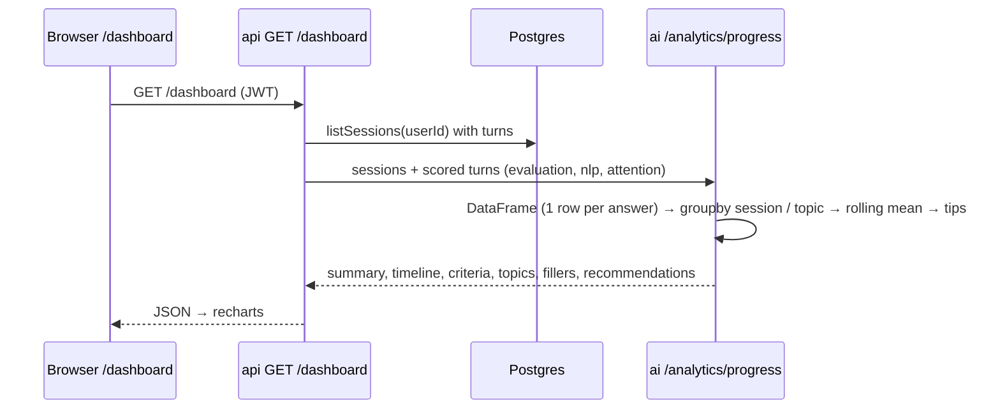

# Phase 8 — Progress dashboard (Pandas → charts)

## What was built
A `/dashboard` page that shows how you improve across interviews: KPI tiles (latest score, change
since the first interview, best interview, practice time), trend lines (overall score + rolling
average, the four rubric criteria, pace, fillers, eye contact, JD keyword use), weakest topics,
your personal filler words, and recommendations. The numbers are computed with Pandas in the AI
service from the history stored in Postgres.

## Concepts from zero
- **Tidy data**: one row per observation (answer), one column per variable (score, wpm…). Every
  question becomes `groupby(...).agg(...)` instead of nested loops.
- **groupby + named aggregation**: `df.groupby("session_id").agg(overall=("score", "mean"))`.
- **Rolling mean**: the average of the last *k* points (`.rolling(3, min_periods=1).mean()`); smooths
  out one good or bad day so the trend is visible.
- **NaN handling**: missing metrics (camera off → no attention) are NaN; `mean()` skips them, and we
  convert NaN to `null` before sending JSON.
- **Rule-based recommendations**: thresholds on aggregated metrics (e.g. fillers > 6/min) produce
  deterministic, explainable advice — no LLM needed.
- **Chart honesty**: one y-axis per chart (never dual axes — pace and fillers have different units,
  so they get separate charts), fixed series colours, legend + direct labels when there are several
  lines, tooltips for exact values, and a table view for accessibility.
- **Separation of concerns**: Postgres stores, Node authorises and fetches, Python analyses, React draws.

## Files to read
1. `ai/app/analytics.py` — the Pandas pipeline (flatten → groupby → rolling → tips).
2. `ai/tests/test_analytics.py` — expected numbers you can verify by hand.
3. `api/src/routes/dashboard.ts` — authorisation + payload shaping + empty short-circuit.
4. `frontend/src/app/dashboard/Charts.tsx` — chart conventions.
5. `frontend/src/app/dashboard/page.tsx` — KPIs, charts, table view.

## Interview questions
1. **Why do the aggregation in Python/Pandas rather than SQL or JavaScript?**
   Metrics live in JSON columns (evaluation, nlp, attention); Pandas flattens and aggregates them in a
   few readable lines and is the analytics tool of the AI service anyway. At larger scale I'd move the
   heavy aggregation into SQL (materialised views) and cache results.
2. **What is a rolling average and why show it?**
   Mean of the last k sessions. Single interviews are noisy (question difficulty varies); the rolling line
   shows the real trend.
3. **How do you handle missing data, e.g. the camera was off?**
   Attention is NaN for those answers; Pandas means skip NaN, the API sends `null`, charts connect over
   gaps and the table shows "–". We never treat missing as zero.
4. **Why not a dual-axis chart for pace and fillers?**
   Two scales on one chart let the designer imply any correlation by choosing the axis ranges. Separate
   charts with honest single axes are easier to read.
5. **How would this scale to many users?**
   The endpoint only processes one user's sessions. For heavy users: paginate/limit history, pre-compute
   per-session aggregates when an interview finishes (store on the session row), and cache the dashboard.

## Exercises
1. Change the rolling window from 3 to 2 in `analytics.py`. Update `test_progress_timeline_sorted_with_rolling_mean`
   with the numbers you compute by hand, and run the test.
2. Add a "best topic" KPI: compute the topic with the highest average score in `progress()`, return it in
   `summary`, and show it as a fifth tile on the dashboard.
