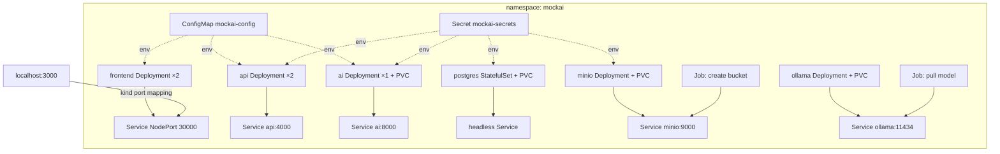

# Phase 9 — Kubernetes, CI/CD, deployment

## What was built
Kubernetes manifests that run the whole stack in a local kind/minikube cluster, a CI job that validates
them against a real API server, honest free-deployment docs, and the recruiter-facing README.

CI (`.github/workflows/ci.yml`): `ai` (ruff + pytest + ml tests) · `api` (eslint + tsc + vitest + build) ·
`frontend` (eslint + vitest + build) · `docker` (build all images) · `k8s` (kustomize → kubeconform →
kind `--dry-run=server`).

## Concepts from zero
- **Pod**: one or more containers scheduled together. You rarely create pods directly.
- **Deployment**: keeps N identical, replaceable pods running; rolling updates. For stateless apps (api, frontend).
- **StatefulSet**: pods with stable names and their own persistent disk — for databases (Postgres).
- **Service**: a stable DNS name + virtual IP in front of pods (`http://api:4000`). `ClusterIP` (internal),
  `NodePort` (reachable on the node), headless (`clusterIP: None`, DNS → pod directly).
- **ConfigMap / Secret**: configuration injected as env vars. Secrets are only base64 in etcd by default —
  real clusters add encryption at rest / external secret managers. Never commit them.
- **PersistentVolumeClaim**: "I need 5 Gi of disk"; the StorageClass provisions it. `ReadWriteOnce` = one
  node at a time → those Deployments use `strategy: Recreate` and 1 replica.
- **Job**: run-to-completion task with retries (create bucket, pull model).
- **Probes**: readiness (send traffic only when ready) vs liveness (restart when hung).
- **Requests/limits**: requests drive scheduling; memory limit = OOM-kill ceiling.
- **Kustomize**: `kubectl apply -k` composes YAML files and adds common labels without templates.
- **kind**: Kubernetes-in-Docker; `kind load docker-image` puts local images into the node — no registry.
- **Server-side dry run**: the API server validates and admits objects without creating them — catches
  errors that schema linting misses, without needing images.

## Files to read
1. `infra/k8s/apps.yaml` — Deployments, probes, resources, why the ai service has 1 replica.
2. `infra/k8s/data.yaml` — StatefulSet vs Deployment, PVCs, Jobs.
3. `infra/k8s/README.md` — the exact run steps.
4. `.github/workflows/ci.yml` — the whole pipeline.
5. `docs/DEPLOYMENT.md` — trade-offs of free hosting.

## Interview questions
1. **Deployment vs StatefulSet — which did you use where?**
   Deployments for stateless api/frontend (any pod can serve any request, scale freely). A StatefulSet for
   Postgres: stable identity and a dedicated volume per replica via volumeClaimTemplates.
2. **Why does the ai service run one replica if it's stateless?**
   Its code is stateless, but Chroma persists to a ReadWriteOnce volume. To scale, move vectors to pgvector or a
   Chroma server; then raise replicas (or add an HPA on CPU).
3. **How do the pods find each other?**
   Services give stable DNS names inside the namespace; the ConfigMap holds URLs like `http://ai:8000`.
4. **How do you handle secrets?**
   A Secret template in git, the real `secret.yaml` git-ignored and applied separately; values injected via
   `secretKeyRef`. In production: sealed-secrets / external secrets + encryption at rest, and RBAC.
5. **What does your CI validate, and what doesn't it?**
   Lint, type-check, unit tests, image builds, manifest schemas and API-server admission. It doesn't run the
   images in a cluster (the AI image + 5 GB model are too heavy for free runners) or test real LLM quality — that's
   covered by manual smoke tests documented in MANUAL_STEPS.

## Exercises
1. Change the api Deployment to `replicas: 3`, apply with `kubectl apply -k infra/k8s`, then delete one api pod
   (`kubectl -n mockai delete pod <name>`) and watch Kubernetes replace it (`kubectl get pods -w`).
2. Break the readiness probe path on the frontend (`/nope`), re-apply, and observe the pods become `0/1 READY`
   while the old ones keep serving. Explain what a rolling update does with unready pods. Revert.
